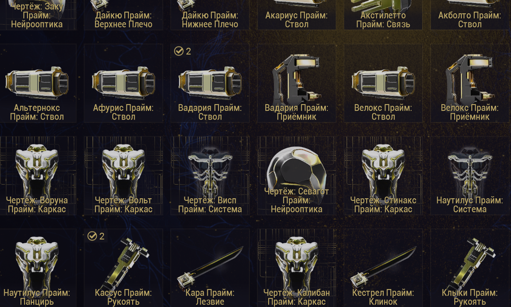
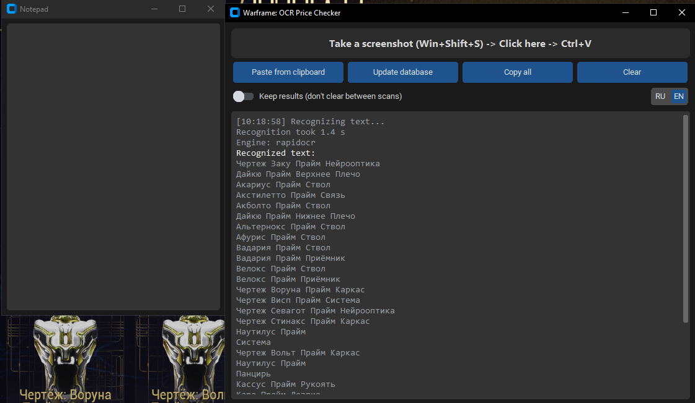
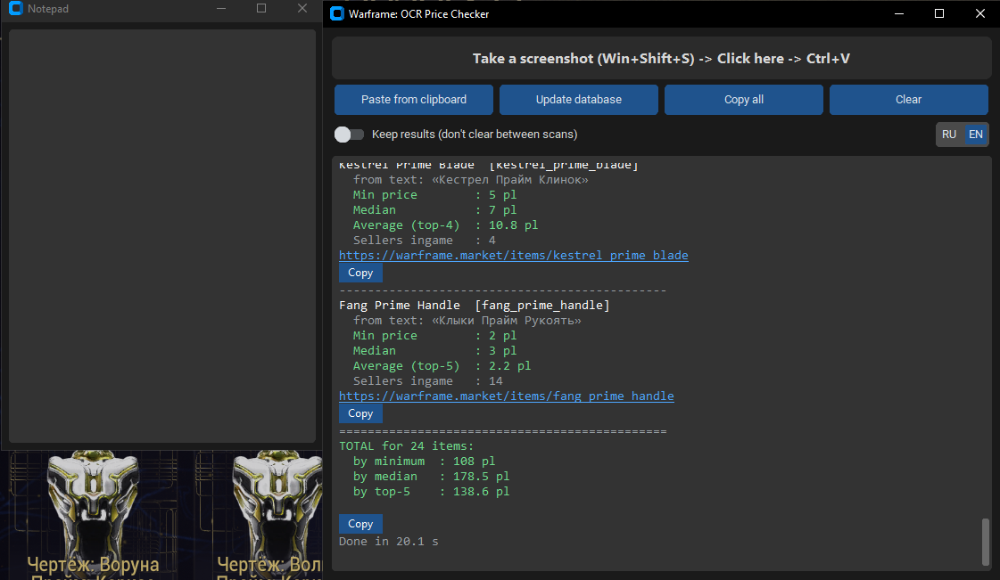
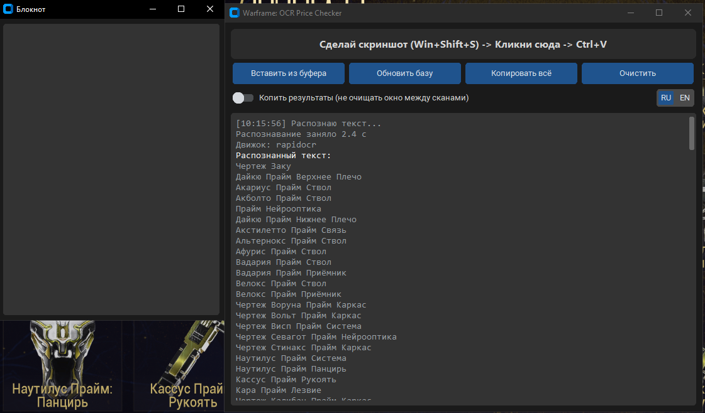
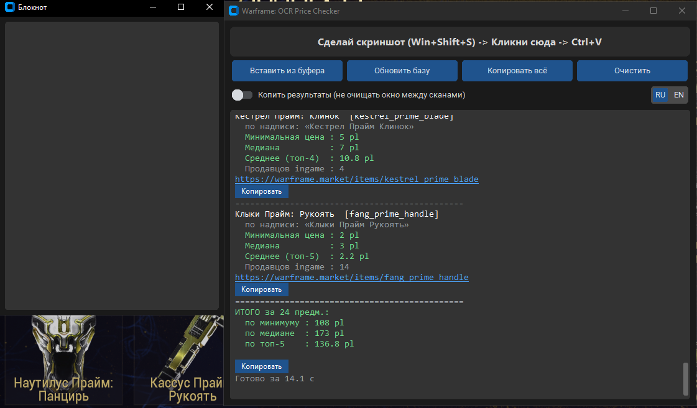

[README.md](https://github.com/user-attachments/files/34725753/README.md)
# Warframe Clipboard Price Checker

**🇬🇧 English** · [🇷🇺 Русская версия ниже](#-русская-версия)

A safe, external price checker for Warframe. Take a screenshot (`Win+Shift+S`), press `Ctrl+V` in the app — and instantly see live **Warframe.Market** prices for every item on it.

> **It never touches the game.** No memory reading, no game files, no logs, no overlay, no injection. The app only reads an image from your clipboard and asks the public Warframe.Market API for prices — so there is nothing for the game's anti-cheat to detect.

---

## ⬇️ Download (no Python needed)

1. Open the **[Releases](../../releases)** page and download the latest `.zip` archive.
2. Unzip it to any folder (keep all files together — don't move the `.exe` out of its folder).
3. Run **`WF_Price_Checker.exe`**.

That's it. On the first launch the app downloads the full item list from Warframe.Market, so you need an internet connection.

> ⚠️ **Windows SmartScreen or your antivirus may warn about the file.** This is a standard false positive for small indie programs built with PyInstaller that have no paid digital signature. The full source code is in this repository, so you can check it yourself or build the program on your own.

## How to use

1. Press `Win+Shift+S` and select the area with items (relic rewards, inventory, mods, arcanes, Prime parts…).
2. Click the app window and press `Ctrl+V` (or the **Paste from clipboard** button).
3. Wait a few seconds — you get prices for every recognized item and a total.

**Tips:** bigger text on the screenshot = better accuracy; a smaller selected area = faster. Press **Update database** every few weeks to get newly released items.

## Screenshots

**1. Select the area with items in the game** (`Win+Shift+S`) — relic rewards, inventory, mods, arcanes, Prime parts:



**2. Paste it into the app** (`Ctrl+V`) — the program reads the item names:



**3. Get prices for every item and the total value**, with a Copy button and a Market link for each one:



*(The game screenshot is from the Russian game client, so the recognized item names are in Russian. The app works with the English client too, and the interface language is switched with the RU / EN button.)*

## Features

- 📸 **Bulk recognition** from one screenshot: relic rewards, inventory, mods, arcanes, Prime parts.
- 🌍 Works with the **Russian and English** game clients.
- 🔄 **Interface language switch** (RU / EN).
- 💰 Price statistics from sellers who are **in game**: minimum, median and the average of the 5 cheapest.
- 📈 For mods and arcanes: prices for **rank 0 and max rank**.
- ➕ **Total** value of everything on the screenshot.
- 📋 A **Copy** button for each item and "Copy all"; clickable Market links.
- 📝 Built-in **notepad with auto-save** (clickable links, copy/paste).
- ⚠️ Warns you when a name may have been recognized incorrectly, so you don't trust a wrong price.

## Project layout

| File | Purpose |
|---|---|
| `main.pyw` / `main.py` | program launcher |
| `gui.py` | windows, buttons, output, notepad |
| `ocr_engine.py` | clipboard image → text, grouping of labels into a grid |
| `matcher.py` | fuzzy matching of names against the item database |
| `market_api.py` | Warframe.Market API v2 (v1 as a fallback), price statistics |
| `database.py` | local SQLite item database |
| `i18n.py` | RU / EN switch |
| `config.py` | settings |

## Disclaimer

This is an **unofficial fan-made tool**. It is not affiliated with, endorsed by or connected to Digital Extremes or Warframe.Market. Prices are a snapshot of current sell orders — double-check before a big trade. Please respect the Warframe.Market API rate limits. Use at your own risk.

<details>
<summary><b>🛠 For developers: run from source / build the .exe</b></summary>

Requirements: Windows 10/11, Python 3.10+.

```
pip install -r requirements.txt
python main.py
```

Double-click `main.pyw` to run without a console window. Text recognition uses **RapidOCR** (small neural network, downloaded on first run if not bundled); **Tesseract OCR** is an optional fallback: https://github.com/UB-Mannheim/tesseract/wiki

Build a Windows folder with the `.exe`:

```
pip install pyinstaller
pyinstaller --noconsole --onedir --name WF_Price_Checker --collect-all rapidocr --collect-all customtkinter --collect-all onnxruntime main.pyw
```

The result is in `dist\WF_Price_Checker\` — zip the whole folder and attach it to a GitHub Release.

</details>

---

# 🇷🇺 Русская версия

# Warframe: чекер цен через буфер обмена

Безопасный внешний чекер цен для Warframe. Сделайте скриншот (`Win+Shift+S`), нажмите `Ctrl+V` в программе — и сразу увидите актуальные цены **Warframe.Market** на все предметы со скриншота.

> **Программа никак не вмешивается в игру.** Она не читает память, не трогает файлы и логи игры, не рисует оверлей и ничего не внедряет. Она только берёт картинку из буфера обмена и запрашивает цены у публичного API Warframe.Market — поэтому античиту нечего обнаруживать.

---

## ⬇️ Скачать (Python не нужен)

1. Откройте страницу **[Releases](../../releases)** и скачайте последний `.zip`-архив.
2. Распакуйте его в любую папку (все файлы должны лежать вместе — не переносите `.exe` из его папки).
3. Запустите **`WF_Price_Checker.exe`**.

Готово. При первом запуске программа скачивает полный список предметов с Warframe.Market, поэтому нужен интернет.

> ⚠️ **Windows SmartScreen или антивирус могут ругаться на файл.** Это стандартное ложное срабатывание для небольших независимых программ, собранных через PyInstaller и не имеющих платной цифровой подписи. Весь исходный код лежит в этом репозитории — вы можете проверить его или собрать программу сами.

## Как пользоваться

1. Нажмите `Win+Shift+S` и выделите область с предметами (награды реликвий, инвентарь, моды, мистификаторы, прайм-части…).
2. Кликните в окно программы и нажмите `Ctrl+V` (или кнопку **«Вставить из буфера»**).
3. Подождите несколько секунд — появятся цены на каждый распознанный предмет и общий итог.

**Советы:** чем крупнее текст на скриншоте, тем точнее результат; чем меньше выделенная область, тем быстрее. Раз в несколько недель нажимайте **«Обновить базу»**, чтобы подтянулись новые предметы.

## Скриншоты

**1. Выделите в игре область с предметами** (`Win+Shift+S`) — награды реликвий, инвентарь, моды, мистификаторы, прайм-части:


**2. Вставьте в программу** (`Ctrl+V`) — программа прочитает названия предметов:



**3. Получите цены на каждый предмет и общий итог**, с кнопкой «Копировать» и ссылкой на Market у каждого:



*(На скриншотах русский интерфейс; на английский переключается кнопкой RU / EN.)*

## Возможности

- 📸 **Массовое распознавание** с одного скриншота: награды реликвий, инвентарь, моды, мистификаторы, прайм-части.
- 🌍 Работает с **русским и английским** клиентом игры.
- 🔄 **Переключатель языка интерфейса** (RU / EN).
- 💰 Статистика цен по продавцам, которые **в игре**: минимум, медиана и среднее по 5 самым дешёвым.
- 📈 Для модов и мистификаторов — цены **без прокачки и максимального ранга**.
- ➕ **Общий итог** по всем предметам на скриншоте.
- 📋 Кнопка **«Копировать»** у каждого предмета и «Копировать всё»; кликабельные ссылки на Market.
- 📝 Встроенный **блокнот с автосохранением** (кликабельные ссылки, копирование и вставка).
- ⚠️ Предупреждает, если название могло распознаться неверно, чтобы вы не доверились неправильной цене.

## Структура проекта

| Файл | Назначение |
|---|---|
| `main.pyw` / `main.py` | запуск программы |
| `gui.py` | окна, кнопки, вывод, блокнот |
| `ocr_engine.py` | изображение из буфера обмена → текст, группировка подписей в сетку |
| `matcher.py` | нечёткое сопоставление названий с базой предметов |
| `market_api.py` | API Warframe.Market v2 (v1 как запасной вариант), статистика цен |
| `database.py` | локальная база предметов SQLite |
| `i18n.py` | переключатель RU / EN |
| `config.py` | настройки |

## Отказ от ответственности

Это **неофициальный фанатский инструмент**. Он не связан с Digital Extremes и Warframe.Market и не одобрен ими. Цены — снимок текущих заявок на продажу: перед крупной сделкой перепроверяйте. Соблюдайте лимиты API Warframe.Market. Используйте на свой риск.

<details>
<summary><b>🛠 Для разработчиков: запуск из исходников / сборка .exe</b></summary>

Требования: Windows 10/11, Python 3.10+.

```
pip install -r requirements.txt
python main.py
```

Двойной клик по `main.pyw` запускает программу без чёрного окна. Для распознавания текста используется **RapidOCR** (небольшая нейросеть, скачивается при первом запуске, если не вложена в сборку); **Tesseract OCR** — необязательный запасной вариант: https://github.com/UB-Mannheim/tesseract/wiki

Сборка папки с `.exe`:

```
pip install pyinstaller
pyinstaller --noconsole --onedir --name WF_Price_Checker --collect-all rapidocr --collect-all customtkinter --collect-all onnxruntime main.pyw
```

Результат лежит в `dist\WF_Price_Checker\` — упакуйте всю папку в zip и приложите к релизу на GitHub.

</details>
